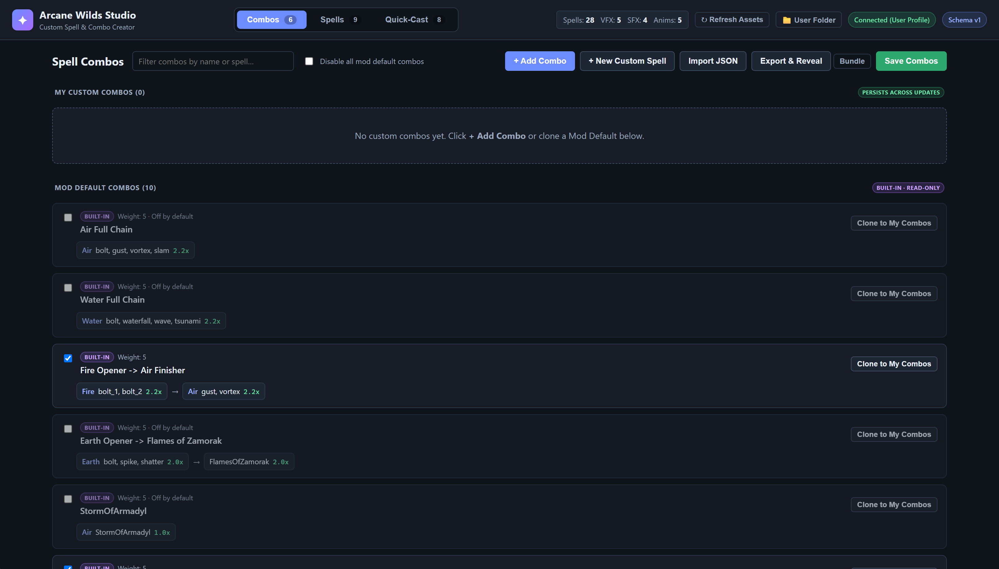
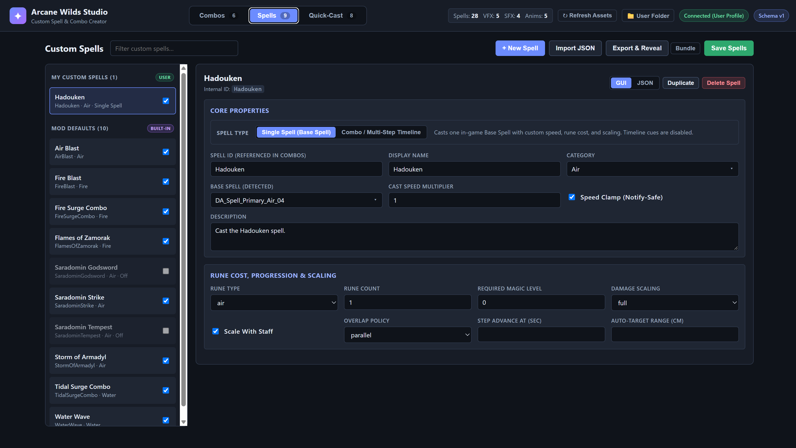
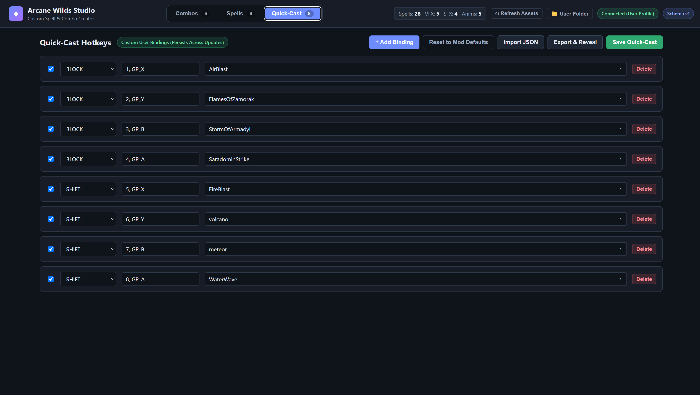

# Arcane Wilds (`ArcaneWilds` v1.1.0)

**Arcane Wilds** is a script-driven **UE4SS** magic combat overhaul and custom spell framework for *RuneScape: Dragonwilds*. It unlocks move-while-casting, adds weighted cross-element and Ancient Magicks combo chaining, provides Block/Modifier Quick-Cast hotkeys with EnhancedInput action suppression, introduces a JSON-schema-validated custom spell timeline engine with crowd control, progression gating, and staff/Magic damage scaling, and fixes vanilla Air finisher aim—all with **zero vanilla asset overrides**.

* **Discord:** [Join our Discord](https://discord.gg/QwktYjdbtx)
* **Support:** [Support on Ko-fi](https://ko-fi.com/zolantris)

---

## Core Gameplay Features

### Movement Unlock (Freecast) & Vanilla Fixes
* **Move-While-Casting (`UnlockAir` / `Fire` / `Water` / `Earth`)**: Removes movement locks and root-motion anchoring during supported Staff and Wand spell montages, with configurable `MaxMoveSpeed` (default `600`).
* **Third-Party & Utility Spell Support**: Automatically discovers and unlocks modded combat spells (`UnlockModdedCombat=true`, e.g., *HydraAncientMagicks*, *Conjurer*, *Ancient Staff*) and optionally utility spells (`UnlockUtilitySpells=false`).
* **4th Air Spell Freedom & Vertical Aim Fix (`FixAir4thVerticalAim=true`)**:
  * Leaves the 4th Air combo unlocked by default (`KeepGroundSmashAnchored=false`; toggle ON to restore rooted vanilla behavior).
  * Runtime-patches `DA_Spell_Primary_Air_04` (and `Air_Wand_04` if present) so `SpellModule_Transform` and `SpellModule_Movement` trigger at cast start (`Immediate` instead of `FinishedCasting`), track `TracedPlayerCameraForward` vertical pitch/rotation like hits 1–3, and raise ground-level spawn offsets to torso height so sloped and elevated shots connect cleanly.

### Block / Stance Modifier & Weighted Combo Chains
* **Stance-Gated Combos (`ModifierKey=RMB`)**: Hold Block (`RMB` / Gamepad `LT` / `LB`)—or rebind to `SHIFT`, `ALT`, `CTRL`, `MOUSE4`, `MOUSE5`, or `MMB`—to engage custom combo macros matching your equipped staff/wand and equipped elemental rune (`MagicAmmo1`) or active Ancient Magicks toggle.
* **Cross-Element, Custom & Modded Chains (`combo_rules.json`)**:
  * Author weighted single-element, multi-stage cross-element, Ancient Magicks, Conjurer, or custom-spell chains with per-stage speed multipliers and `BonusSpeedVariancePct` randomization.
  * Automatically returns to your original equipped anchor element before rolling a new chain, and resets cleanly when you release Block or swap weapons/runes.
  * Validated by `schemas/combo_rules.schema.json` with ready-to-copy templates in `combo_rules_examples.json` and friendly aliases in `spell_names.txt`.
* **Hold-to-Auto-Attack (`EnableAutoAttackHold=true`)**: Hold Left-Click (`LMB`) or Right Trigger (`RT`) to chain casts continuously when idle—both inside Block/Modifier combos and on standard attacks (`AutoAttackAllCombos=true`).

### Quick-Cast Hotkeys & EnhancedInput Suppression
* **Direct Spell & Combo Hotkeys (`quick_cast.json` & Mod Menu)**:
  * Cast any custom spell, native `DA_Spell_*` asset, or inline combo chain instantly using keyboard and controller bindings (with `Block`, `Shift`, `Alt`, `Ctrl`, or `None` modifiers).
  * Ships with 4 default bindings (editable in `quick_cast.json` for unlimited slots, or via Slots #1–#4 in Mod Menu / `config.txt`):
    * `Block + 1` / `GP_X` -> **Saradomin Godsword**
    * `Block + 2` / `GP_Y` -> **Flames of Zamorak**
    * `Block + 3` / `GP_B` -> **Storm of Armadyl**
    * `Block + 4` / `GP_A` -> **Saradomin Strike**
* **Conflict-Free Input Suppression (`QuickCastSuppressGameActions=true`)**: Dynamically constructs a high-priority `UInputMappingContext` and `UInputAction` at runtime while holding your Quick-Cast modifier so vanilla Hotbar 1–4 and controller face-button actions do not trigger alongside Quick-Cast, restoring normal bindings immediately on release.

### Animation Pacing, Special Abilities & Rune Accuracy
* **Notify-Safe Speed Clamping (`EnableFinisherSpeedClamp=true`)**: Drives live speed via `Montage_SetPlayRate` (keeping `RateScale=1.0` so rates are never squared) and clamps delayed/multi-stage finishers (`Meteor`, `Volcano`, `Air Slam`, `Boulder`, or `clamp: true` custom spells) to `MaxFinisherSpeedClamp` (`5.0x` default) so `AnimNotify` damage and projectile spawns are never skipped.
* **Special Ability & Repeat-Animation Pacing**: Supports special energy bar injection/checks (`InjectSpecialBarOnSpecials`, `RequireSpecialEnergyForSpecials`), special cast speed capping (`MaxSpecialCastRate`), post-special cooldown pauses (`PostSpecialPauseSec`), and repeat-montage padding (`AnimRepeatPadSec`).
* **Rune-Accurate Consumption (`ConsumeRunesOnSwappedCasts=true`)**: Detects equipped staves/wands and `MagicAmmo1` runes via `PlayerEquipmentComponent` / `LoadoutComponent` hooks and deducts matching runes or spell cost items from inventory on swapped and custom casts.

---

## Custom Spell Framework (`custom_spells.json`)

Define complete custom spells in `custom_spells.json` (JSONC comments and trailing commas supported, validated by `schemas/custom_spells.schema.json`, with legacy `custom_spells.txt` fallback).

### Built-In Custom Spells
| Spell ID | Display Name | Req. Level | Rune Cost | Summary |
| :--- | :--- | :---: | :---: | :--- |
| `FlamesOfZamorak` | Flames of Zamorak | Magic 20 | 2× Fire | Powered by `DA_ZamorakStaff_Special` with speed scaling and finisher clamp. |
| `SaradominStrike` | Saradomin Strike | Magic 30 | 2× Air | Line-of-sight `chainstrike` lightning barrage that scales strike count with Magic level, prioritizes unique nearby enemies, stuns targets, and scales with staff & Magic stats. |
| `StormOfArmadyl` | Storm of Armadyl | Magic 77 | 2× Air | Fires an Air Bolt with projectile impact tracking (`trackImpact`), erupting a windstorm AoE on impact with pushback, knockup, stun, and staff/Magic damage scaling. |
| `SaradominGodsword` | Saradomin Godsword | — | 1× Air | Spawns `BP_Godsword_Special_Saradomin_C` with the 2H Greatsword secondary montage and melee spin AoE hitbox. |
| `SaradominTempest` *(disabled)* | Saradomin Tempest | — | 2× Air | Reference template demonstrating layered multi-slot animations, ring-pattern VFX, `GE_AddBurning`, and target hit-react cues. |

### Timeline Cue Engine & Combat Effects
* **Cue Types**: `anim`, `weaponAnim`, `targetAnim`, `vfx` (Niagara with float/vector user parameters and `point`/`ring`/`line`/`arc` spawn patterns), `sfx`, `actor`, `spell` (with optional projectile `trackImpact`), `hit`, `decal`, `shake`, and `chainstrike`.
* **Synchronization & Layering**: Anchor cues with absolute timestamps (`@0.35`), simultaneous/synced starts (`&`, `&id+0.15`), or chained after-end triggers (`>`, `>id-0.10`), slot-layered montages (`FullBody`, `LeftArm`, `RightArm`, etc.), `overlapPolicy` (`replace` / `parallel` / `ignore`), `stepAdvanceAt`, and `cancelOnRelease`.
* **Crowd Control & Hit Effects**: `hit` and `chainstrike` cues support damage ranges, damage classes (`Magical`, `Melee`, `Ranged`), hit-reaction force, **Stun** (with montage interrupt), **Root/Snare**, **Slow** (multiplier + duration), **Pushback / Pull**, **Knockup (`launchZ`)**, and GameplayEffects (e.g., `GE_AddBurning`).
* **Auto-Targeting & Target Lock-On**: Respects active lock-on, reticle hover, and configurable crosshair-cone acquisition (`AutoTargetMaxDistance`, `AutoTargetConeDeg`, `RequireLockOnForChainSpells`, plus per-spell `autoTarget` overrides).

### Progression Gating & Staff / Magic Damage Scaling
* **Skill Level Gating (`EnforceSpellLevelRequirements=true`)**: Checks `requiredMagicLevel` (or any `requiredSkill`) against native `USkillComponent` levels for both Quick-Cast and combo rules, displaying native in-game HUD notifications (`UNotificationsSubsystem`) when a player attempts to cast a locked spell.
* **Dynamic Damage Scaling (`EnableStaffDamageScaling=true`)**: Supports `damageScaling` modes (`full`, `staff`, `magic`, `none`) combining equipped staff tier, weapon damage multipliers, Masterwork bonus, per-staff keyword bonuses (`staffBonus`), Magic skill damage modifier, and live player Magic/Staff/Elemental attributes.

### Companion Damage Bridge (`.pak`) & Runtime Safety
* **Zero Vanilla Asset Overrides**: All core gameplay patches run in Lua at runtime—patch-safe and compatible with `.pak` mods.
* **Optional Companion `ArcaneWildsDamageBridge_P.pak`**: Bundled in release archives (`Content/Paks/~mods/`), this tiny cooked Blueprint Function Library (`/Game/Mods/ArcaneWilds/BFL_ArcaneWildsDamage`) routes custom spell hits cleanly through native `UDamageComponent::PredictDamage` and `UDamageFunctionLibrary::ApplyDamage` for native damage floaties and hit reactions. If omitted, Arcane Wilds automatically falls back to direct Lua calls.
* **Stability Guards**: Executes all UObject/input/timeline logic on a single serialized Game-Thread tick (~40 Hz with watchdog recovery), validates UE asset classes before playing cues, and automatically clears casting tags, active timelines, and input blockers on player death, respawn, or pawn change.

---

## Controls Quick Reference

| Action | Keyboard / Mouse | Controller |
| :--- | :--- | :--- |
| **Engage Combo Macro** | Hold `RMB` (Block) + `LMB` | Hold `LT` or `LB` + `RT` |
| **Hold-to-Auto-Attack** | Hold `LMB` | Hold `RT` |
| **Quick-Cast Slots #1–#4** | Hold `RMB` + `1` / `2` / `3` / `4` | Hold `LT` or `LB` + `X` / `Y` / `B` / `A` |
| **Debug Dump & Live Reload** | `SHIFT + \` (`DebugHotkey`) | *(Keyboard only)* |

---

## Arcane Wilds Studio (Visual Config Editor)

Use **Arcane Wilds Studio** to visually build and edit **Spell Combos**, **Custom Spells**, and **Quick-Cast Hotkeys** without hand-editing JSON.

* **Web Studio (GitHub Pages — no install required):** [https://zolantris.github.io/runescape-dragonwilds-mods/](https://zolantris.github.io/runescape-dragonwilds-mods/)
  * Edit configs in your browser, then click **Export & Reveal** (or **Bundle**) and drop the exported `user_*.json` files into `%LOCALAPPDATA%\RSDragonwilds\Saved\Config\ArcaneWilds\`.
  * Also publishes [`llms.txt`](https://zolantris.github.io/runescape-dragonwilds-mods/llms.txt), JSON schemas, and the asset catalog so you can generate spells/combos with an AI assistant and paste them via **Import JSON**.
* **Local Mode (1-click Save & live hot-reload):** Double-click `Launch-ArcaneWilds-Editor.bat` inside `ue4ss/Mods/ArcaneWilds/` (or run `.\mod.ps1 editor arcane-wilds`) to save directly to `%LOCALAPPDATA%\RSDragonwilds\Saved\Config\ArcaneWilds\` and hot-reload changes in-game immediately.

> **Full step-by-step tutorial:** See [`docs/studio-guide.md`](./docs/studio-guide.md).

### Combos Editor


### Custom Spells Editor


### Quick-Cast Hotkeys Editor


---

## Configuration, Mod Menu & Hot-Reload

Most runtime settings can be edited live in-game via **Mod Menu** (`Esc > MODS > Arcane Wilds`) or directly in `ue4ss/Mods/ArcaneWilds/`. Saving any editable file (`Ctrl+S`) **hot-reloads automatically in-game**—and if a JSON syntax error is saved, Arcane Wilds keeps the previous valid rules/spells active and logs the error.

| File | Purpose |
| :--- | :--- |
| `config.txt` | Core toggles, modifier key, Quick-Cast slots #1–#4, Freecast movement toggles, speed clamps, auto-targeting, staff scaling, progression gating, and debug flags. |
| `modmenu.json` | Mod Menu UI schema exposing runtime settings under `Esc > MODS`. |
| `combo_rules.json` | Active weighted combo chains (validated by `schemas/combo_rules.schema.json`; templates in `combo_rules_examples.json`). |
| `custom_spells.json` | Custom spell definitions, requirements, scaling, and cue timelines (validated by `schemas/custom_spells.schema.json`). |
| `quick_cast.json` | Unlimited Quick-Cast spell & inline combo hotkey bindings. |
| `spell_names.txt` | Friendly name-to-asset aliases (e.g., `Air.slam = DA_Spell_Primary_Air_04`, Ancient Magicks, Conjurer). |
| `detected_spells.txt` / `detected_vfx.txt` | Auto-exported catalogs of loaded `DominionSpellData` assets, montages, and Niagara VFX paths (plus optional user-created `vfx_names.txt` aliases). |

> **Tip (Interactive Debug Hotkey & Inspection)**: Set `AllowDebugCommands=true` and press `SHIFT + BackSlash` (`\`) in-game to force-reload configs, refresh `detected_spells.txt` / `detected_vfx.txt`, and log live staff/Magic scaling, lock status, InputBlocker state, and combo-to-asset bindings. Set `DebugHotkey=LISTEN` in `config.txt` to rebind interactively by pressing any key.

---

## Installation & Multiplayer

### Vortex (Recommended)
1. Download `ArcaneWilds-vX.Y.Z.zip` from Releases and drag it into Vortex.
2. Enable and deploy (Vortex installs `RSDragonwilds/Binaries/Win64/ue4ss/Mods/ArcaneWilds/` and `RSDragonwilds/Content/Paks/~mods/ArcaneWildsDamageBridge_P.pak`).

### Manual Installation
1. Copy `ue4ss/Mods/ArcaneWilds/` into `<GameDir>/RSDragonwilds/Binaries/Win64/`.
2. *(Optional, recommended for custom spell damage/floaties)* Copy `ArcaneWildsDamageBridge_P.pak` into `<GameDir>/RSDragonwilds/Content/Paks/~mods/`.
3. Verify `enabled.txt` exists inside `ue4ss/Mods/ArcaneWilds/`.

### Multiplayer
* Works client-side for Freecast and standard chaining.
* Recommend **Host + Clients** both install Arcane Wilds (including `ArcaneWildsDamageBridge_P.pak`) when using high animation speed multipliers or custom timeline spells/VFX/SFX.

---

## Development, Building & Testing

From the monorepo root:

```powershell
# Validate JSON configs/schemas and run the offline Lua 5.4 test suite
.\mod.ps1 test arcane-wilds

# Build Vortex-ready archive (UE4SS Lua + ArcaneWildsDamageBridge_P.pak)
.\mod.ps1 build arcane-wilds

# Build without UE pak (Lua-only archive)
.\mod.ps1 build arcane-wilds -SkipPak

# Cleanly wipe and deploy ArcaneWilds to your game directory
.\mod.ps1 build-deploy arcane-wilds
```

See [`scripts/README.md`](../scripts/README.md) and [`unreal-engine/README.md`](../unreal-engine/README.md) for packaging and Damage Bridge details.

## Changelog

<!-- CHANGELOG:START -->
### v1.1.0
_Changes since [ArcaneWilds-v1.0.0](https://github.com/zolantris/runescape-dragonwilds-mods/releases/tag/ArcaneWilds-v1.0.0)_


- **2026-11-28** - Chore/builtin spells working for quickcast (#11) ([853a9be](https://github.com/zolantris/runescape-dragonwilds-mods/commit/853a9bea07de0599f4b1d9c188eabbc3bea45b86))
- **2026-11-27** - Fix/ensure abilities work and studio works (#10) ([a65eef3](https://github.com/zolantris/runescape-dragonwilds-mods/commit/a65eef358a066253704a3737ccc0080c209d573a))
- **2026-11-27** - add workflow to create release (#7) ([997830e](https://github.com/zolantris/runescape-dragonwilds-mods/commit/997830ea255d1923aec605b4121697ab7ef49490))
- **2026-11-27** - use game local folder over top level arcanewilds folder if it exists (#8) ([9ed1efb](https://github.com/zolantris/runescape-dragonwilds-mods/commit/9ed1efb2ea58a2e00357d83f4a757378f6fdfc35))
- **2026-11-27** - Chore/bbcode formatter and readme updates (#6) ([b22dba2](https://github.com/zolantris/runescape-dragonwilds-mods/commit/b22dba24ce62fff4820893ae6284adb196855cf5))
- **2026-11-27** - skip if lua or json was not modified for lua and json tests (#5) ([95c5469](https://github.com/zolantris/runescape-dragonwilds-mods/commit/95c5469fca7251130e73fda94e1cccaa9fe66961))
- **2026-11-27** - use latest github actions and fix deploy (#4) ([24db8e3](https://github.com/zolantris/runescape-dragonwilds-mods/commit/24db8e350e1e2855d0db407c5a62e96c1d652b95))
- **2026-11-27** - Feat/arcane wilds gui (#3) ([4f26f92](https://github.com/zolantris/runescape-dragonwilds-mods/commit/4f26f925b03681a0693aa1f165a1c5af7a282471))
### v1.0.0

- **2026-11-26** - - set arcane-wilds to 1.0.0 - set fire combos on ([60f8ab7](https://github.com/zolantris/runescape-dragonwilds-mods/commit/60f8ab7af6288ca8433d3800c321599c885e324b))
- **2026-11-26** - Feat/arcane wilds mod (#2) ([81141a8](https://github.com/zolantris/runescape-dragonwilds-mods/commit/81141a88c65a41f36e66791ca9fb1e5c30069699))
- **2026-11-22** - Fix missing commits issue with stale tag ([122495f](https://github.com/zolantris/runescape-dragonwilds-mods/commit/122495fbe7cc96152d1b7b8b7021c8fd063b6eee))
- **2026-11-22** - Fix changelog linking ([39366ca](https://github.com/zolantris/runescape-dragonwilds-mods/commit/39366cae242e63c55f17e1a5a194e15bdc702e03))
- **2026-11-22** - autocommit release readme updates before pushing tag ([7733b20](https://github.com/zolantris/runescape-dragonwilds-mods/commit/7733b20bf5083a9e8a0d174afb3af1f0ff387718))
- **2026-11-22** - bump to 1.3.6 to test diff again ([9a6f2c8](https://github.com/zolantris/runescape-dragonwilds-mods/commit/9a6f2c8b466785b44fd2e3d1cc637c12ed98d603))
- **2026-11-22** - bump to 1.3.5 to test diff ([c272bc9](https://github.com/zolantris/runescape-dragonwilds-mods/commit/c272bc95b53e9946a1041cdd043eca5cde3efc29))
- **2026-11-22** - get publish release script to work and show diff ([57b6884](https://github.com/zolantris/runescape-dragonwilds-mods/commit/57b6884859107241bc15e5fd28685e5300f947f4))
- **2026-11-22** - Fix release scripts and update readme ([927ad9d](https://github.com/zolantris/runescape-dragonwilds-mods/commit/927ad9da46c48f830c966e3f32b852b933e2975f))
- **2026-11-22** - reorganize repo ([150120c](https://github.com/zolantris/runescape-dragonwilds-mods/commit/150120cad88104ab9cc93e3671de690898012a0c))
- **2026-11-22** - 1.2.9 working with both pause menu and inventory alignment and does not interfere with other panels ([76fab60](https://github.com/zolantris/runescape-dragonwilds-mods/commit/76fab605670f4b24d88be91b1935571c0560eb21))
- **2026-11-22** - Initial commit ([0739035](https://github.com/zolantris/runescape-dragonwilds-mods/commit/0739035e6728071f701375b584fe1cfc1f7b3517))
- **2026-11-26** - Feat/arcane wilds mod (#2) ([81141a8](https://github.com/zolantris/runescape-dragonwilds-mods/commit/81141a88c65a41f36e66791ca9fb1e5c30069699))
- **2026-11-22** - Fix missing commits issue with stale tag ([122495f](https://github.com/zolantris/runescape-dragonwilds-mods/commit/122495fbe7cc96152d1b7b8b7021c8fd063b6eee))
- **2026-11-22** - Fix changelog linking ([39366ca](https://github.com/zolantris/runescape-dragonwilds-mods/commit/39366cae242e63c55f17e1a5a194e15bdc702e03))
- **2026-11-22** - autocommit release readme updates before pushing tag ([7733b20](https://github.com/zolantris/runescape-dragonwilds-mods/commit/7733b20bf5083a9e8a0d174afb3af1f0ff387718))
- **2026-11-22** - bump to 1.3.6 to test diff again ([9a6f2c8](https://github.com/zolantris/runescape-dragonwilds-mods/commit/9a6f2c8b466785b44fd2e3d1cc637c12ed98d603))
- **2026-11-22** - bump to 1.3.5 to test diff ([c272bc9](https://github.com/zolantris/runescape-dragonwilds-mods/commit/c272bc95b53e9946a1041cdd043eca5cde3efc29))
- **2026-11-22** - get publish release script to work and show diff ([57b6884](https://github.com/zolantris/runescape-dragonwilds-mods/commit/57b6884859107241bc15e5fd28685e5300f947f4))
- **2026-11-22** - Fix release scripts and update readme ([927ad9d](https://github.com/zolantris/runescape-dragonwilds-mods/commit/927ad9da46c48f830c966e3f32b852b933e2975f))
- **2026-11-22** - reorganize repo ([150120c](https://github.com/zolantris/runescape-dragonwilds-mods/commit/150120cad88104ab9cc93e3671de690898012a0c))
- **2026-11-22** - 1.2.9 working with both pause menu and inventory alignment and does not interfere with other panels ([76fab60](https://github.com/zolantris/runescape-dragonwilds-mods/commit/76fab605670f4b24d88be91b1935571c0560eb21))
- **2026-11-22** - Initial commit ([0739035](https://github.com/zolantris/runescape-dragonwilds-mods/commit/0739035e6728071f701375b584fe1cfc1f7b3517))
<!-- CHANGELOG:END -->
