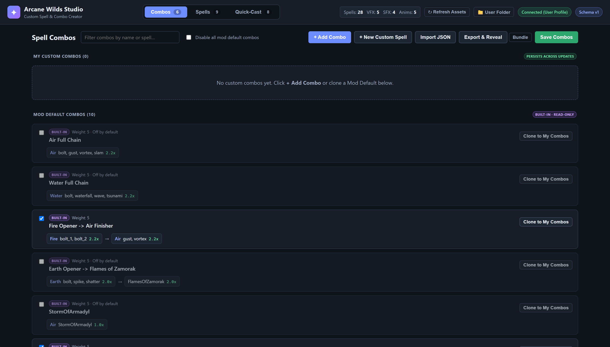
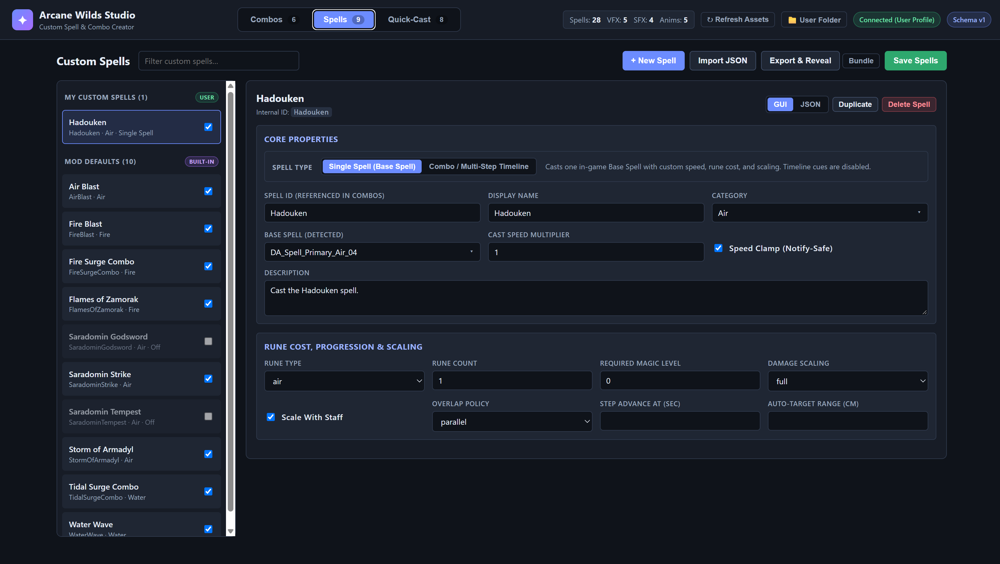
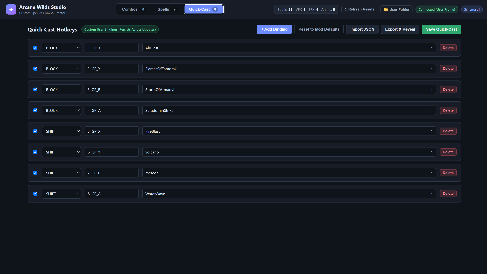

# Arcane Wilds Studio — User Guide & Tutorial

**Arcane Wilds Studio** is a visual editor for creating and customizing **Spell Combos**, **Custom Spells**, and **Quick-Cast Hotkeys** without hand-editing JSON files.

You can use it directly in your browser on **GitHub Pages** or run it **locally** alongside the game for 1-click saving and live hot-reload.

---

## Option A: Use the Web Studio (GitHub Pages)

Open the hosted studio in any browser (no installation required):

> **Live Web Studio:** [https://zolantris.github.io/runescape-dragonwilds-mods/](https://zolantris.github.io/runescape-dragonwilds-mods/)

1. **Optional — Load your game's detected assets:** Click **Load detected_catalog.json** in the top banner and select `detected_catalog.json` from your `ue4ss/Mods/ArcaneWilds/` folder so modded spells, VFX, SFX, and animations appear in autocomplete dropdowns. (Otherwise, the studio uses the built-in fallback catalog.)
2. **Edit** your Combos, Custom Spells, and Quick-Cast Hotkeys across the three tabs.
3. **Export your config:** Click **Export & Reveal** (or **Bundle** to export Spells + Combos together) to download your JSON file(s).
4. **Install into your user folder:** Move the downloaded files (`user_combos.json`, `user_spells.json`, `user_quick_cast.json`) into:
   ```text
   %LOCALAPPDATA%\RSDragonwilds\Saved\Config\ArcaneWilds\
   ```
   Configs stored in `%LOCALAPPDATA%\RSDragonwilds\Saved\Config\ArcaneWilds\` persist across mod updates and hot-reload automatically in-game.

---

## Option B: Run Locally (1-Click Save & Live Hot-Reload)

For the fastest workflow while playing or testing:

1. Double-click **`Launch-ArcaneWilds-Editor.bat`** inside your installed `ue4ss/Mods/ArcaneWilds/` folder (or run `.\mod.ps1 editor arcane-wilds` from this repository).
2. Your browser will open `http://localhost:47821` with a green **Connected** status badge.
3. Click **Save Combos**, **Save Spells**, or **Save Quick-Cast** to write atomically to `%LOCALAPPDATA%\RSDragonwilds\Saved\Config\ArcaneWilds\`—Arcane Wilds detects the change and hot-reloads in-game immediately.
4. Use **↻ Refresh Assets** after pressing the in-game debug dump hotkey (`SHIFT + \`) to pull newly loaded spells/VFX/SFX into the editor, or click **📁 User Folder** to open `%LOCALAPPDATA%\RSDragonwilds\Saved\Config\ArcaneWilds\` in Explorer.

---

## Tab-by-Tab Walkthrough

### 1. Combos Tab (`user_combos.json`)
Build weighted single-element, cross-element, Ancient Magicks, or custom-spell combo chains triggered while holding your modifier key (`RMB` / `LT` / `LB`).



* **+ Add Combo**: Create a new weighted combo rule, choose its trigger element/category, add ordered spell stages, and tune per-stage speed multipliers.
* **+ New Custom Spell**: Jump straight to creating a custom spell to reference inside a combo.
* **Disable all mod default combos**: Toggle this on if you want *only* your custom combo rules to roll.
* **Import JSON / Export & Reveal / Bundle**: Share combo packs or paste AI-generated JSON directly into the studio.

### 2. Spells Tab (`user_spells.json`)
Author complete custom spells with timelines, Niagara VFX, SFX, animation montages, crowd control, progression gating, and staff/Magic damage scaling.



* **+ New Spell**: Start a new custom spell (or select an existing built-in spell from the left sidebar to inspect or override it).
* **Timeline Cues**: Add `anim`, `vfx`, `sfx`, `spell`, `hit`, `chainstrike`, `actor`, `decal`, or `shake` cues with synchronized timing (`@0.35`, `&`, `>`).
* **Validation**: All edits are validated against the Draft-07 JSON schemas before saving.

### 3. Quick-Cast Tab (`user_quick_cast.json`)
Bind any custom spell, native `DA_Spell_*` asset, or inline combo chain to keyboard or controller hotkeys.



* **+ Add Binding**: Pick a modifier (`Block`, `Shift`, `Alt`, `Ctrl`, or `None`), assign one or more keys/gamepad buttons, and select the target spell or combo.
* **Reset to Mod Defaults**: Revert back to the 4 built-in Quick-Cast slots at any time.

---

## Using AI Assistants to Generate Spells & Combos

The GitHub Pages deployment also publishes [`llms.txt`](https://zolantris.github.io/runescape-dragonwilds-mods/llms.txt), Draft-07 JSON schemas, and the asset catalog (`fallback_catalog.json`).

1. Point your AI assistant at `https://zolantris.github.io/runescape-dragonwilds-mods/llms.txt` and describe the spell, combo, or hotkey setup you want.
2. Copy the generated JSON.
3. Click **Import JSON** in the corresponding tab of Arcane Wilds Studio, paste the JSON, review it visually, and click **Save** or **Export & Reveal**.
